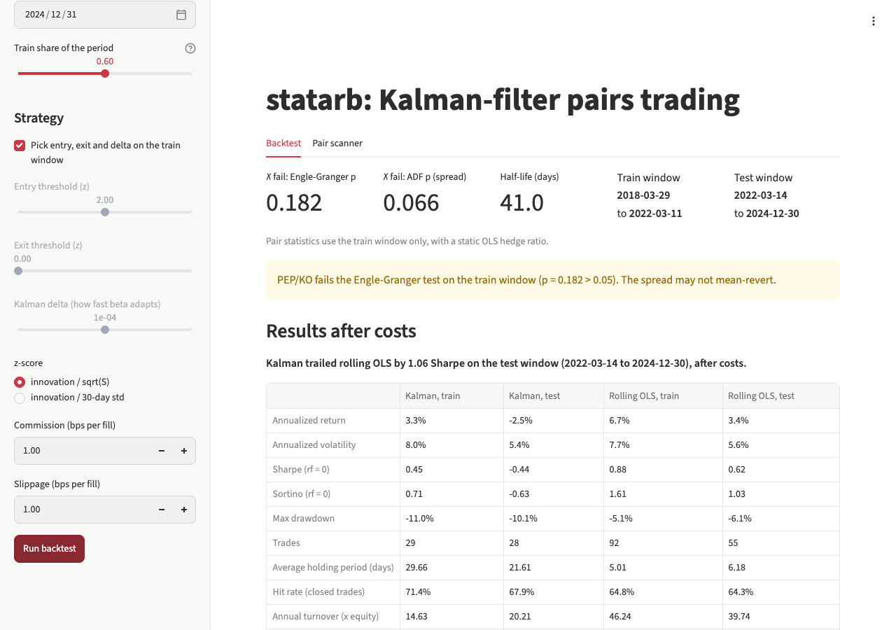

# statarb

A daily-bar pairs-trading backtester with a Kalman-filter hedge ratio, cointegration tests and a rolling-OLS baseline.



The app is not deployed yet; run it locally with the Quickstart below. More screenshots: [full page](docs/app-1280-light-full.png), [dark mode](docs/app-1280-dark.png), [390 px light](docs/app-390-light.png), [390 px dark](docs/app-390-dark.png).

## How it works

**Model.** For a target Y and a reference X, the observation equation is

$$y_t = \alpha_t + \beta_t x_t + e_t, \qquad e_t \sim N(0, R)$$

and the state $s_t = [\beta_t, \alpha_t]$ follows a random walk, $s_t = s_{t-1} + w_t$ with $w_t \sim N(0, Q)$ (`src/math_model.py`, `KalmanFilterReg`).

**Noise settings.** The first 60 bars are a warm-up. An OLS fit of y on [x, 1] over the warm-up sets the starting state, its covariance $P_0 = R (H^\top H)^{-1}$, and $R$ = the warm-up residual variance. The state noise is $Q = \frac{\delta}{1-\delta} \cdot n P_0$, the per-bar OLS covariance scaled by `delta`, so the same `delta` means the same adaptation speed for a $5 stock and a $500 stock. Larger `delta` lets beta move faster and makes it noisier.

**z-score.** Each bar the filter's one-step-ahead innovation $y_t - (\alpha_{t-1} + \beta_{t-1} x_t)$ is divided by $\sqrt{S_t}$, the model's innovation variance. A rolling alternative divides by the standard deviation of the previous 30 innovations.

**Bar order.** For each bar t: (1) mark the shares held since t-1 to bar t's close, (2) update the filter with bar t, (3) decide the new position from $z_t$ and fill at bar t's close. No trades happen during the warm-up.

**Signals.** Flat: short the spread (short Y, long X) when $z > $ entry, long it when $z < -$entry. Long: exit when $z \ge -$exit. Short: exit when $z \le$ exit.

**Sizing.** On entry, gross notional equals equity (`gross_notional=1.0`): $|n_y| p_y + |n_x| p_x = E$, with $n_x = -\beta n_y$. Cash is debited for every fill and equity is cash plus holdings at every bar.

**Costs.** Commission and slippage, each 1 basis point by default, are charged on the traded notional of every fill.

**Baseline.** `RollingOLS` refits y on [x, 1] over the last 20, 40 or 60 bars. Its innovation and $S$ come from the fit that excludes bar t, and it goes through the same warm-up, signal, sizing and cost code.

**Train and test.** The first 60% of the period is the train window. Entry (1.0 to 2.5), exit (0 or 0.5) and `delta` (1e-5 to 1e-3) or the OLS window are picked by the highest train-window Sharpe, using only train-window bars. Both models then run on the whole period and the metrics are reported separately for the later test window.

**Pair statistics** (`src/stats.py`, train window only): Engle-Granger p-value, ADF p-value of the static-OLS spread, half-life $-\ln 2 / \ln \phi$ from an AR(1) fit of the spread, and optionally the Johansen trace test. The app shows a warning when the Engle-Granger p-value exceeds 0.05.

**Scanner.** The second tab runs Engle-Granger on every pair in a ticker list (default: 11 large US consumer-staples stocks), adjusts the p-values with Benjamini-Hochberg at 5%, and loads a selected pair into the backtest.

## Quickstart

These commands were run from a clean clone on macOS with Python 3.15. The pinned dependencies need Python 3.12 or later.

```bash
git clone https://github.com/allenwang0/statarb.git
cd statarb
python3 -m venv .venv
.venv/bin/pip install -e ".[dev]"
.venv/bin/streamlit run app.py               # the app, downloads from Yahoo Finance
.venv/bin/pytest -q                          # offline tests on synthetic data
.venv/bin/ruff check . && .venv/bin/mypy src
.venv/bin/python scripts/make_report.py      # writes reports/report.html and reports/results.md
```

## Results

Generated by `python scripts/make_report.py` at commit af58d37 on 2026-11-12. Costs are 1 bp commission plus 1 bp slippage per fill. Returns use a zero risk-free rate.

**PEP (Y) against KO (X)**, Yahoo Finance adjusted daily closes, 2018-01-01 to 2024-12-31. Train window 2018-03-29 to 2022-03-11, test window 2022-03-14 to 2024-12-30. On the train window the pair fails the Engle-Granger test (p = 0.182; ADF p on the spread 0.066; half-life 41.0 days), so the app shows its warning for this pair.

| Metric | Kalman, train | Kalman, test | Rolling OLS, train | Rolling OLS, test |
|---|---|---|---|---|
| Annualized return | 3.3% | -2.5% | 6.7% | 3.4% |
| Annualized volatility | 8.0% | 5.4% | 7.7% | 5.6% |
| Sharpe (rf = 0) | 0.45 | -0.44 | 0.88 | 0.62 |
| Sortino (rf = 0) | 0.71 | -0.63 | 1.61 | 1.03 |
| Max drawdown | -11.0% | -10.1% | -5.1% | -6.1% |
| Trades | 29 | 28 | 92 | 55 |
| Average holding period (days) | 29.66 | 21.61 | 5.01 | 6.18 |
| Hit rate (closed trades) | 71.4% | 67.9% | 64.8% | 64.3% |
| Annual turnover (x equity) | 14.63 | 20.21 | 46.24 | 39.74 |
| Annual cost drag | 0.3% | 0.4% | 0.9% | 0.8% |

Chosen on the train window: Kalman entry 1.5, exit 0, delta 1e-5; rolling OLS entry 1.5, exit 0.5, window 20. On the test window the Kalman filter trailed rolling OLS by 1.06 Sharpe after costs.

The Kalman model does not fit this pair: its standardized innovations have variance 20.2 instead of 1, and all 20 autocorrelations at lags 1 to 20 sit outside the 95% band. The warm-up residual variance understates the spread's real variance, so model z-scores are too large. The "Does the model fit?" charts in the app show this for any pair.

**Synthetic data** (generated in code, seed 42, not market prices): 1,500 bars, beta 1.5, AR(1) spread with phi 0.95. Train window 2000-03-27 to 2003-06-13, test window 2003-06-16 to 2005-09-30.

| Metric | Kalman, train | Kalman, test | Rolling OLS, train | Rolling OLS, test |
|---|---|---|---|---|
| Sharpe (rf = 0) | 1.85 | 1.15 | 2.03 | 1.50 |
| Annualized return | 9.1% | 5.3% | 4.9% | 2.8% |
| Max drawdown | -4.0% | -3.8% | -2.3% | -1.0% |
| Trades | 45 | 30 | 15 | 5 |

On the synthetic pair the Kalman filter also trailed rolling OLS on the test window, by 0.35 Sharpe. The full tables and charts are in `reports/report.html` after running the script. Price data comes from Yahoo Finance at run time and is not redistributed; `reports/` is not committed.

## Relationship to quantsim

statarb stays a standalone tool for one pair at a time. [quantsim](https://github.com/allenwang0/quantsim) is an event-driven engine with its own `PairsTradingStrategy`. `tests/test_kalman.py` here is the contract for the filter.

## Limitations

- Daily closes only, and fills happen at the same close that produced the signal. Slippage is the only allowance for not getting that price.
- Data comes from yfinance, which can rate-limit, change its output format or drop symbols. There is no retry.
- Shorting is free: no borrow fees, no margin interest, no short rebate, and cash earns nothing.
- One pair at a time. The scanner screens pairs but does not trade a portfolio of them.
- Results depend on `delta`, the thresholds and the split date. The grid search picks the best train-window Sharpe out of 24 settings per model, which overstates train-window results.
- The Kalman z-score assumes white measurement noise. For real pairs whose spread is autocorrelated, the model z-score is not standardized; check the diagnostics charts or use the rolling z-score.

## License

No license file has been added yet, so default copyright applies.
