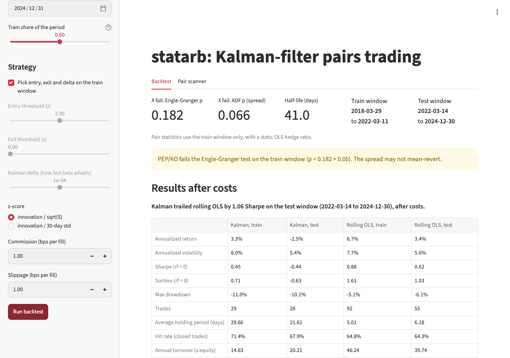

# statarb

A pairs-trading research app: a Kalman filter tracks the hedge ratio between two stocks bar by bar, a scanner finds cointegrated pairs with false-discovery control, and every strategy is tuned on a train window and judged on an untouched test window against a rolling-OLS baseline.



More screenshots: [full page](docs/app-1280-light-full.png), [dark mode](docs/app-1280-dark.png), [390 px light](docs/app-390-light.png), [390 px dark](docs/app-390-dark.png).

## Highlights

- **Kalman-filter hedge ratio** with a time-varying intercept, with state noise scaled so one `delta` adapts at the same speed for a $5 stock and a $500 stock.
- **Cointegration scanner** with Benjamini-Hochberg correction at 5%, so screening 55 pairs does not hand you a list of false positives.
- **Train/test discipline.** Parameters are fit on the first 60% of the period; results are reported separately for the untouched test window.
- **Shared cost model and baseline.** A rolling-OLS hedge runs through the same warm-up, signal, sizing and cost code (1 bp commission plus 1 bp slippage per fill).
- **Model diagnostics** show whether the Kalman model actually fits a given pair.

## Quickstart

Python 3.11 or 3.12.

```bash
git clone https://github.com/allenwang0/statarb.git && cd statarb
python3 -m venv .venv
.venv/bin/pip install -e ".[dev]"
.venv/bin/streamlit run app.py              # the app; downloads prices from Yahoo Finance
.venv/bin/pytest -q                         # offline tests on synthetic data
.venv/bin/python scripts/make_report.py     # writes reports/report.html and reports/results.md
```

## How it works

**Model.** For a target Y and a reference X, the observation equation is

$$y_t = \alpha_t + \beta_t x_t + e_t, \qquad e_t \sim N(0, R)$$

and the state $s_t = [\beta_t, \alpha_t]$ follows a random walk, $s_t = s_{t-1} + w_t$ with $w_t \sim N(0, Q)$ (`src/math_model.py`, `KalmanFilterReg`).

**Noise settings.** An OLS fit of y on [x, 1] over the first 60 bars sets the starting state, its covariance $P_0 = R (H^\top H)^{-1}$, and $R$, the warm-up residual variance. The state noise is $Q = \frac{\delta}{1-\delta} \cdot n P_0$, the per-bar OLS covariance scaled by `delta`. Larger `delta` lets beta move faster and makes it noisier.

**z-score.** The one-step-ahead innovation $y_t - (\alpha_{t-1} + \beta_{t-1} x_t)$ is divided by $\sqrt{S_t}$, the model's innovation variance. A rolling alternative divides by the standard deviation of the previous 30 innovations.

**Bar order and signals.** Each bar: mark positions to the close, update the filter, then trade on $z_t$ at that close. No trades during the warm-up. Flat: short the spread (short Y, long X) when $z > $ entry, long it when $z < -$entry. Long: exit when $z \ge -$exit. Short: exit when $z \le$ exit.

**Sizing.** On entry, gross notional equals equity: $|n_y| p_y + |n_x| p_x = E$, with $n_x = -\beta n_y$.

**Baseline.** `RollingOLS` refits y on [x, 1] over the last 20, 40 or 60 bars. Its innovation and $S$ come from the fit that excludes bar t.

**Parameter search.** Entry (1.0 to 2.5), exit (0 or 0.5) and `delta` (1e-5 to 1e-3) or the OLS window are chosen by the highest train-window Sharpe: 24 settings per model.

**Pair statistics** (`src/stats.py`, train window only): Engle-Granger p-value, ADF p-value of the static-OLS spread, half-life $-\ln 2 / \ln \phi$ from an AR(1) fit of the spread, and optionally the Johansen trace test. The app warns when the Engle-Granger p-value exceeds 0.05.

**Scanner.** Runs Engle-Granger on every pair in a ticker list (default: 11 large US consumer-staples stocks), adjusts p-values with Benjamini-Hochberg and loads a selected pair into the backtest.

## Results

From `scripts/make_report.py`, after costs, zero risk-free rate.

**PEP (Y) against KO (X)**, Yahoo Finance adjusted daily closes, 2018-01-01 to 2024-12-31. Train 2018-03-29 to 2022-03-11, test 2022-03-14 to 2024-12-30. On the train window the pair fails Engle-Granger (p = 0.182; ADF p on the spread 0.066; half-life 41.0 days), so the app flags it.

| Metric | Kalman, train | Kalman, test | Rolling OLS, train | Rolling OLS, test |
|---|---|---|---|---|
| Annualized return | 3.3% | -2.5% | 6.7% | 3.4% |
| Annualized volatility | 8.0% | 5.4% | 7.7% | 5.6% |
| Sharpe (rf = 0) | 0.45 | -0.44 | 0.88 | 0.62 |
| Sortino (rf = 0) | 0.71 | -0.63 | 1.61 | 1.03 |
| Max drawdown | -11.0% | -10.1% | -5.1% | -6.1% |
| Trades | 29 | 28 | 92 | 55 |
| Average holding period (days) | 29.66 | 21.61 | 5.01 | 6.18 |
| Hit rate (closed trades) | 71.4% | 67.9% | 64.8% | 64.3% |
| Annual turnover (x equity) | 14.63 | 20.21 | 46.24 | 39.74 |
| Annual cost drag | 0.3% | 0.4% | 0.9% | 0.8% |

Chosen on train: Kalman entry 1.5, exit 0, delta 1e-5; rolling OLS entry 1.5, exit 0.5, window 20.

**Finding: on this pair the simpler hedge wins.** Rolling OLS beat the Kalman filter out of sample, 0.62 Sharpe versus -0.44 after costs. The diagnostics explain why: the Kalman model's standardized innovations have variance 20.2 instead of 1, and all 20 autocorrelations at lags 1 to 20 sit outside the 95% band. The warm-up residual variance understates the spread's real variance, so model z-scores run too large. That is what the train/test split and the diagnostics are there to catch.

**Synthetic pair** (seed 42, 1,500 bars, beta 1.5, AR(1) spread with phi 0.95). Train 2000-03-27 to 2003-06-13, test 2003-06-16 to 2005-09-30.

| Metric | Kalman, train | Kalman, test | Rolling OLS, train | Rolling OLS, test |
|---|---|---|---|---|
| Sharpe (rf = 0) | 1.85 | 1.15 | 2.03 | 1.50 |
| Annualized return | 9.1% | 5.3% | 4.9% | 2.8% |
| Max drawdown | -4.0% | -3.8% | -2.3% | -1.0% |
| Trades | 45 | 30 | 15 | 5 |

On a truly cointegrated pair both hedges make money out of sample; rolling OLS still leads by 0.35 Sharpe. Price data is downloaded at run time and not redistributed.

## Limitations

- Daily closes only, and fills happen at the close that produced the signal. Slippage is the only allowance for not getting that price.
- yfinance can rate-limit, change its format or drop symbols, and there is no retry.
- Shorting is free: no borrow fees, margin interest or short rebate, and cash earns nothing.
- One pair at a time. The scanner screens pairs but does not trade a portfolio of them.
- Train-window results are the best of 24 settings per model and are optimistic by construction; judge the test window.
- The Kalman z-score assumes white measurement noise. When a real spread is autocorrelated, check the diagnostics or use the rolling z-score.

## Related

[quantsim](https://github.com/allenwang0/quantsim) is an event-driven backtesting engine with its own `PairsTradingStrategy`; `tests/test_kalman.py` here is the shared contract for the filter.

MIT licensed. See [LICENSE](LICENSE).
